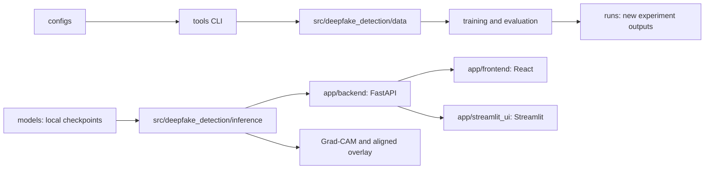

# Explainable Deepfake Detection System

A local university research prototype for **still-image** face classification as FAKE or REAL. Its primary demonstration checkpoint is Xception Clean. The system includes face detection and cropping, calibrated inference, optional Grad-CAM attribution, a FastAPI service, and React and Streamlit clients. Existing research code also includes EfficientNet-B0 and auxiliary architectures.

The class convention is `fake = 0`, `real = 1`. The run-managed binary model emits a real-class logit; inference converts it to calibrated real probability and defines fake score as its complement. A model score is not proof that media is authentic or manipulated. Grad-CAM shows regions that influenced the selected score; it is not a forgery mask.

## Current status

- Seven restored run-managed models passed strict CPU checkpoint loading after migration to `models/`; their checkpoint SHA-256 values are unchanged. Six calibration references still match their model hashes.
- The legacy Xception Focal checkpoint is preserved under `models/archive/xception_focal_legacy/`. It is architecture-loadable, but its class direction and preprocessing are unverified and it is disabled in ordinary inference.
- The source includes image decoding, face detection, inference, calibration, Grad-CAM, API history, and two clients. Real-photo end-to-end inference has not been verified because no permissioned face image was provided.
- Video upload and temporal video analysis are not implemented.
- Historical evaluation metrics are documented internally, but several are not tied to a restorable run-bound prediction report; this README makes no accuracy claim.

## Architecture



The `src/deepfake_detection/` package contains reusable ML code and has no dependency on the user interfaces. FastAPI calls the shared inference engine. React and Streamlit call the API. Restored model artifacts are separate from new training outputs: `models/` stores the selected and archived local models; `runs/` remains the default destination for newly created experiments and service history.

## Repository layout

```text
app/backend/                 FastAPI app and API-specific persistence
app/frontend/                React/Vite still-image client
app/streamlit_ui/            Streamlit still-image client
src/deepfake_detection/
  data/                       manifests, grouping, MTCNN and preprocessing
  models/                     Xception/EfficientNet, loading and registry
  training/                   trainer, optimizers, scheduling and checkpoints
  evaluation/                 metrics, calibration, testing and Grad-CAM
  inference/                  reusable still-image inference engine
  common/                     configuration, paths, logging and utilities
models/primary/xception_clean/ selected local demonstration model
models/archive/               other preserved model artifacts
configs/                      experiment recipes
runs/                         new experiment outputs and local history database
tools/                        workflow and comparison commands
tests/                        Python unittest suite
weights/                      optional local ImageNet initialization files
data/, crops/                 local data only; not included in Git
docs/                         internal review documents; excluded from Git
```

## Requirements

- Windows 11 or another supported Python platform.
- Python 3.11.
- Dependencies declared in `requirements.txt` (PyTorch, torchvision, timm, facenet-pytorch, OpenCV, Pillow, FastAPI, scikit-learn and related utilities).
- Node.js/npm for React.
- Optional NVIDIA CUDA runtime compatible with the selected PyTorch build. CPU inference is supported but slower.

## Windows PowerShell setup

Run these from the project root. Select the correct PyTorch/torchvision wheel for your machine before installing the remaining requirements if CUDA is needed.

```powershell
py -3.11 -m venv .venv
.\.venv\Scripts\Activate.ps1
python -m pip install --upgrade pip
python -m pip install -r requirements.txt
python -m pip install -e . --no-deps
```

Do not install a second large PyTorch build over a working environment without checking its version and CUDA compatibility first. The project copy's historical `venv/` is not portable; create a fresh environment using the commands above.

`.env.example` contains local defaults only, not secrets. PowerShell does not automatically load it. Set optional values in the active terminal when needed:

```powershell
$env:DEEPFAKE_MODEL_ID = "xception-clean"
$env:DEEPFAKE_PORT = "8000"
$env:VITE_API_BASE_URL = "http://127.0.0.1:8000"
```

## Local model files

Git excludes trained checkpoints, model artifacts, ImageNet weights, crops, raw data, and internal documentation. Obtain artifacts only from an authorized source. The primary model must be restored as a complete directory at:

```text
models/primary/xception_clean/
```

Keep `config.json`, `input_manifest.json`, `best_metadata.json`, the exact hash-named checkpoint referenced by that metadata, and the matching calibration pointer/version files together. The loader checks checkpoint integrity and preprocessing/model contracts. The registry ID is `xception-clean`. Optional verified archived run folders belong under their corresponding `models/archive/` directories. Focal is not available as a trusted classifier.

Historical training metadata retain original run locations for provenance; those paths are not the current artifact locations.

## Run the applications

Start the backend on localhost:

```powershell
python -m tools.laptop_workflow serve --run xception-clean --port 8000
```

It exposes `/health`, `/analyze`, and `/history`. `create_app()` is an application factory rather than a module-level singleton, so use the CLI command above; it selects the registered model and binds the service to localhost. For deployment automation, the app factory can be invoked with Uvicorn's `--factory` option after a model deployment has been selected.

Start the React client in another terminal:

```powershell
Set-Location approntend
npm install
npm test
npm run dev
```

Or start Streamlit from the project root:

```powershell
python -m streamlit run app/streamlit_ui/streamlit_app.py
```

This is a localhost prototype without authentication or production hardening. Do not expose it to a public network.

## Analyze a still image

Use the React or Streamlit client to upload a permissioned JPEG/PNG, or call the API directly:

```powershell
curl.exe -X POST "http://127.0.0.1:8000/analyze?explain=true" `
  -H "Content-Type: image/jpeg" `
  --data-binary "@C:\path	o\permissioned-face.jpg"
```

The response includes detected faces and per-face scores. A failed face detection or unusable crop does not receive a real/fake verdict. No manipulation-method classifier is provided.

## CLI and tests

```powershell
python -m tools.laptop_workflow --help
python -m unittest discover -s tests -v
Push-Location approntend
npm test
Pop-Location
```

Python tests use `unittest` fixtures and mocks. They do not validate full external datasets or replace a permissioned real-image/MTCNN/API test. No training command is run by importing the package.

## Privacy and limitations

- Analysis history is stored locally under `runs/service/history.sqlite3`; result records can include image previews and Grad-CAM overlays. Treat this database as private image-derived data.
- Uploaded image processing is local by default. URL fetching is restricted to public HTTPS addresses, but local file upload is preferable for a classroom demonstration.
- Model run manifests refer to source crops outside this clean copy. Model loading is verified; historical data-backed training is not reproducible from this repository alone.
- Recorded source-group checks do not establish universal person-identity independence.
- Real-image face detection, prediction, and visual heatmap alignment remain unverified here because no permissioned image was supplied.
- No software license is declared. Dataset and checkpoint terms remain with their respective owners.

## Technology

Python 3.11, PyTorch, torchvision, timm, facenet-pytorch/MTCNN, OpenCV, Pillow, FastAPI, Streamlit, React, Vite, SQLite, and `unittest`.
